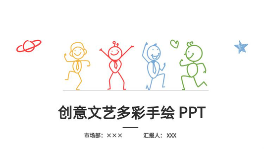
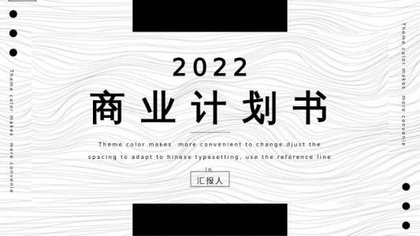
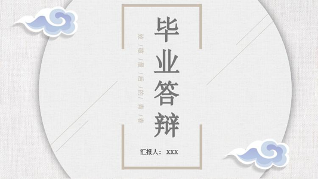
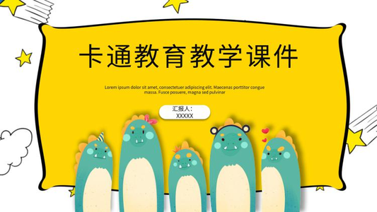
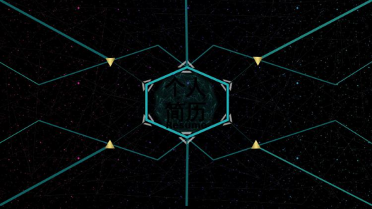
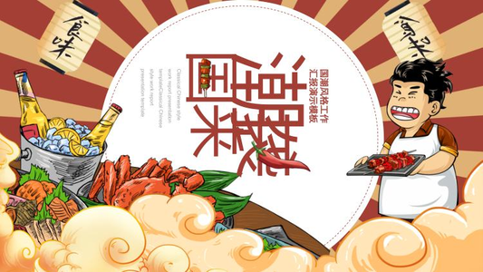
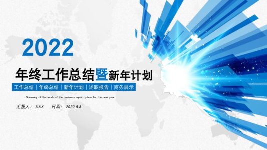
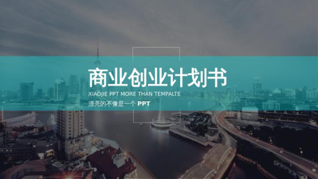
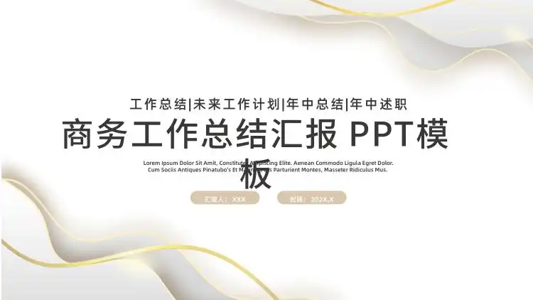
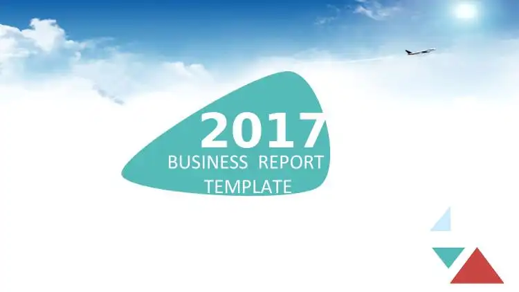

# PPT 模板库索引


> 把夸克网盘里一套 **7000+ 文件 / 65.9 GB** 的中文 PPT 模板库，整理成可检索、可直达、带封面预览的目录索引。
> **只索引、只预览：不存储原文件、不提供下载。**

**快速导航**　[风格掠影](#风格掠影) · [精选六套](#精选模板) · [分类总表](#分类总表) · [目录结构](#目录结构示例) · [怎么用](#怎么用) · [完整目录](docs/CATALOG.md) · [结构化数据](data/catalog.json)

---

## 这是什么

一个「模板库黄页」：把散落在网盘分享里的模板按风格/用途分类列清楚，配上封面缩略图，让你**先看样式、再决定去夸克预览哪一套**，不用先下载 65 GB 才知道里面有什么。

| 维度 | 数量 |
|---|---:|
| 顶层分类 | **52** |
| 文件总数 | **7006**（其中 PPT 模板 **3527**） |
| 目录数 | 160 |
| 总体积 | **65.9 GB** |
| 封面/预览图 | 3479 张 |
| 原始分享 | [pan.quark.cn/s/180767425d31](https://pan.quark.cn/s/180767425d31)（分享者：夸父\*010，永久有效） |

覆盖场景：工作总结、年终总结、毕业答辩、教学课件、竞聘简历、商务汇报、产品发布、项目策划、年会颁奖、婚庆、快闪、国潮/中国风、莫兰迪、扁平、科技、文艺……

---

## 风格掠影

每张都是对应分类里的真实封面（点击进入该分类）：

|  |  |  |
|:--:|:--:|:--:|
| <a href="https://pan.quark.cn/s/180767425d31#/list/share/4113371c3aa64dd6aa94c81c95d74ebb"></a><br>**极简简约** · 14 套 | <a href="https://pan.quark.cn/s/180767425d31#/list/share/b9f165bf736749d1858f4828d5afad89"></a><br>**商务汇报** · 15 套 | <a href="https://pan.quark.cn/s/180767425d31#/list/share/25a04bed13b04662a0662ced868a31ef"></a><br>**毕业答辩** · 19 套 |
| <a href="https://pan.quark.cn/s/180767425d31#/list/share/22e427ebbb3648079160d59d08e0eb9a"></a><br>**教学课件** · 16 套 | <a href="https://pan.quark.cn/s/180767425d31#/list/share/da34c3ee751b400bb70568d9d8f3d842"></a><br>**个人简历** · 65 套 | <a href="https://pan.quark.cn/s/180767425d31#/list/share/fa1d54cccf594c85b73c3ca37d6c2619"></a><br>**文艺风格** · 40 套 |
| <a href="https://pan.quark.cn/s/180767425d31#/list/share/339bcab192a74bfda1939582f4a97f64"></a><br>**国潮** · 2 套 | <a href="https://pan.quark.cn/s/180767425d31#/list/share/a959005ced1d486a949d9c11e74fd89b"></a><br>**科技风** · 4 套 | <a href="https://pan.quark.cn/s/180767425d31#/list/share/426a515d0e0042deaac610bb220cc63c"></a><br>**快闪** · 3 套 |
| <a href="https://pan.quark.cn/s/180767425d31#/list/share/a8202a07c9af455090644d3c447a2ee4"></a><br>**婚庆爱情** · 7 套 | <a href="https://pan.quark.cn/s/180767425d31#/list/share/b14505ffd6c04640a7c998b9e351334a"></a><br>**路演金融** · 73 套 | <a href="https://pan.quark.cn/s/180767425d31#/list/share/3f596f0816cc494d96fe59ec991938d5"></a><br>**卡通** · 6 套 |

> 封面来自分享页自动生成的缩略图，仅用于索引展示；版权归原作者，如侵权请联系移除。

---

## 精选模板

从 52 个分类里挑出的 6 套代表，覆盖不同用途。点封面可直达对应网盘目录。

### 01 · 莫兰迪工作总结

<a href="https://pan.quark.cn/s/180767425d31#/list/share/3b3f96902cd3472a8b7e1dee909c9a02"></a>

| 项 | 内容 |
|---|---|
| 分类 | [09莫兰迪](https://pan.quark.cn/s/180767425d31#/list/share/3b3f96902cd3472a8b7e1dee909c9a02) · 4 套 |
| 文件 | `莫兰迪工作总结.pptx` · 12.3 MB |
| 风格 | 低饱和莫兰迪色系、大面积留白，干净不抢内容 |
| 适合 | 年度总结、部门汇报、需要「高级感但不花哨」的场合 |

### 02 · 淡雅中国风

<a href="https://pan.quark.cn/s/180767425d31#/list/share/f7888ddfeb5245459b5cc49deab09fb1"></a>

| 项 | 内容 |
|---|---|
| 分类 | [8-中国风格](https://pan.quark.cn/s/180767425d31#/list/share/f7888ddfeb5245459b5cc49deab09fb1) · 101 套 |
| 文件 | `中国风格(01).pptx` · 11.7 MB |
| 风格 | 水墨远山 + 折扇、青蓝灰调，克制雅致 |
| 适合 | 文化类汇报、节庆活动、政企场合 |

### 03 · 白金极简年中总结

<a href="https://pan.quark.cn/s/180767425d31#/list/share/8bbd88f5f4ff42449398f194ce781b69"></a>

| 项 | 内容 |
|---|---|
| 分类 | [01高端PPT](https://pan.quark.cn/s/180767425d31#/list/share/8bbd88f5f4ff42449398f194ce781b69) · 11 套 |
| 文件 | `白金极简工作汇报年中工作总结PPT模板宣传PPT动态PPT.pptx` · 12.0 MB |
| 风格 | 白金配色、极简排版，含动态效果 |
| 适合 | 年中/年终汇报、对外提案 |

### 04 · 年会颁奖盛典

<a href="https://pan.quark.cn/s/180767425d31#/list/share/e4284380073441abb52f50063f04203d"></a>

| 项 | 内容 |
|---|---|
| 分类 | [15-年会颁奖](https://pan.quark.cn/s/180767425d31#/list/share/e4284380073441abb52f50063f04203d) · 115 套 |
| 文件 | `年会颁奖盛典晚会 (1).pptx` · 19.8 MB |
| 风格 | 深蓝星空 + 金色奖杯，舞台感强 |
| 适合 | 年会、颁奖典礼、庆典开场 |

### 05 · 扁平商务

<a href="https://pan.quark.cn/s/180767425d31#/list/share/101c49b9dca44d96b114009c3f3887b0"></a>

| 项 | 内容 |
|---|---|
| 分类 | [30-扁平风格](https://pan.quark.cn/s/180767425d31#/list/share/101c49b9dca44d96b114009c3f3887b0) · 77 套 |
| 文件 | `扁平风格(1).ppt` · 5.1 MB |
| 风格 | 扁平插画、明快配色 |
| 适合 | 产品介绍、培训课件、年轻化表达 |

### 06 · 竖版快闪

<a href="https://pan.quark.cn/s/180767425d31#/list/share/d8770a514cba4531a8cdffbd76f190d9"></a>

| 项 | 内容 |
|---|---|
| 分类 | [17-快闪PPT模板-竖版03](https://pan.quark.cn/s/180767425d31#/list/share/d8770a514cba4531a8cdffbd76f190d9) · 14 套 |
| 文件 | `【模板1】模仿苹果107秒制作的137秒快闪PPT模板.pptx` · 27.7 MB |
| 风格 | 竖屏快闪、强节奏切换，适合手机端播放 |
| 适合 | 发布会开场、短视频素材、活动倒计时 |

---

## 分类总表

点击分类名可直接进入夸克对应目录。共 52 个分类、3527 套模板。

| # | 分类 | PPT 模板 |
|---|------|---------:|
| 1 | [0极简简约](https://pan.quark.cn/s/180767425d31#/list/share/4113371c3aa64dd6aa94c81c95d74ebb) | 14 |
| 2 | [01高端PPT](https://pan.quark.cn/s/180767425d31#/list/share/8bbd88f5f4ff42449398f194ce781b69) | 11 |
| 3 | [2-年终总结](https://pan.quark.cn/s/180767425d31#/list/share/43733ff9dfbd4ee8877a54b8fd373d50) | 72 |
| 4 | [03毕业答辩](https://pan.quark.cn/s/180767425d31#/list/share/25a04bed13b04662a0662ced868a31ef) | 19 |
| 5 | [04新年](https://pan.quark.cn/s/180767425d31#/list/share/c127fca4512047ddad01c0977e6212f7) | 6 |
| 6 | [05商务](https://pan.quark.cn/s/180767425d31#/list/share/b9f165bf736749d1858f4828d5afad89) | 15 |
| 7 | [06教学课件](https://pan.quark.cn/s/180767425d31#/list/share/22e427ebbb3648079160d59d08e0eb9a) | 16 |
| 8 | [07工作总结](https://pan.quark.cn/s/180767425d31#/list/share/160d8cde6f1d40ec879a0fe92a39a772) | 19 |
| 9 | [8-中国风格](https://pan.quark.cn/s/180767425d31#/list/share/f7888ddfeb5245459b5cc49deab09fb1) | 101 |
| 10 | [08求职竞聘](https://pan.quark.cn/s/180767425d31#/list/share/b93cd3f84c1748e6a4697f9873d4c437) | 10 |
| 11 | [9-文艺风格](https://pan.quark.cn/s/180767425d31#/list/share/fa1d54cccf594c85b73c3ca37d6c2619) | 40 |
| 12 | [09莫兰迪](https://pan.quark.cn/s/180767425d31#/list/share/3b3f96902cd3472a8b7e1dee909c9a02) | 4 |
| 13 | [10鎏金风](https://pan.quark.cn/s/180767425d31#/list/share/3a414d844e754e8b82a45e5283b5b7d5) | 4 |
| 14 | [11科技](https://pan.quark.cn/s/180767425d31#/list/share/a959005ced1d486a949d9c11e74fd89b) | 4 |
| 15 | [12中式PPT](https://pan.quark.cn/s/180767425d31#/list/share/be88d5c8849f4b9fb4215c75bf6c45f6) | 8 |
| 16 | [13-培训课件](https://pan.quark.cn/s/180767425d31#/list/share/0e48b86070b444739f122e0bbd008906) | 43 |
| 17 | [13颁奖](https://pan.quark.cn/s/180767425d31#/list/share/cba8ce8bf41c4cc68fcc8f95797612b2) | 5 |
| 18 | [15-年会颁奖](https://pan.quark.cn/s/180767425d31#/list/share/e4284380073441abb52f50063f04203d) | 115 |
| 19 | [15婚庆爱情](https://pan.quark.cn/s/180767425d31#/list/share/a8202a07c9af455090644d3c447a2ee4) | 7 |
| 20 | [16-路演金融](https://pan.quark.cn/s/180767425d31#/list/share/b14505ffd6c04640a7c998b9e351334a) | 73 |
| 21 | [16卡通](https://pan.quark.cn/s/180767425d31#/list/share/3f596f0816cc494d96fe59ec991938d5) | 6 |
| 22 | [17-快闪PPT模板-竖版03](https://pan.quark.cn/s/180767425d31#/list/share/d8770a514cba4531a8cdffbd76f190d9) | 14 |
| 23 | [17文艺](https://pan.quark.cn/s/180767425d31#/list/share/7f395119c43848fb9b2895b27192c036) | 10 |
| 24 | [18-快闪PPT模板-宽版05](https://pan.quark.cn/s/180767425d31#/list/share/2899e0beb3b74f1090dab2e1d13f108e) | 62 |
| 25 | [18动态PPT](https://pan.quark.cn/s/180767425d31#/list/share/21083b071a154cbcaa5064763969ea41) | 5 |
| 26 | [19-快闪PPT模板-宽版04](https://pan.quark.cn/s/180767425d31#/list/share/008d8159d5a84d039dcbb46a3f96c9ab) | 57 |
| 27 | [19快闪](https://pan.quark.cn/s/180767425d31#/list/share/426a515d0e0042deaac610bb220cc63c) | 3 |
| 28 | [20-快闪PPT模板-宽版02](https://pan.quark.cn/s/180767425d31#/list/share/7fcdc8aefddd4421aebf75b98d0f61aa) | 109 |
| 29 | [20绿色环保](https://pan.quark.cn/s/180767425d31#/list/share/776eacc7ea9041e8b4411c6f33174e0b) | 2 |
| 30 | [21-快闪PPT模板-宽版01](https://pan.quark.cn/s/180767425d31#/list/share/3234c6f57f8449ae9069e4432f105a0d) | 50 |
| 31 | [21IOS](https://pan.quark.cn/s/180767425d31#/list/share/9bd8d63e970242e18f8c22b845815809) | 2 |
| 32 | [22剪纸风](https://pan.quark.cn/s/180767425d31#/list/share/835ffc7fd30c4da78016e5e8daaa315b) | 2 |
| 33 | [23美食](https://pan.quark.cn/s/180767425d31#/list/share/a12fe01178f14a03a89095c8e4216c59) | 3 |
| 34 | [24国潮](https://pan.quark.cn/s/180767425d31#/list/share/339bcab192a74bfda1939582f4a97f64) | 2 |
| 35 | [25朋克](https://pan.quark.cn/s/180767425d31#/list/share/35e0deed419540fd95d537fa3c6cb6ed) | 2 |
| 36 | [26-个人简历](https://pan.quark.cn/s/180767425d31#/list/share/da34c3ee751b400bb70568d9d8f3d842) | 65 |
| 37 | [26竞选-小学生](https://pan.quark.cn/s/180767425d31#/list/share/7291e71549c04253906e508cc485761e) | 3 |
| 38 | [27欧美大气](https://pan.quark.cn/s/180767425d31#/list/share/66607e79e0004d54a4916f7dba6f4f3c) | 4 |
| 39 | [28-创意风格](https://pan.quark.cn/s/180767425d31#/list/share/c323566d235b4fc3b1eef8fcd5013258) | 59 |
| 40 | [29-产品发布](https://pan.quark.cn/s/180767425d31#/list/share/5e16e6bf41be45368ff04053bbb02365) | 20 |
| 41 | [30-扁平风格](https://pan.quark.cn/s/180767425d31#/list/share/101c49b9dca44d96b114009c3f3887b0) | 77 |
| 42 | [36-手绘风格](https://pan.quark.cn/s/180767425d31#/list/share/857959c15d844cdf849b1f5e27e4cd92) | 90 |
| 43 | [49-室内设计](https://pan.quark.cn/s/180767425d31#/list/share/cae0655b760f465aa9f35deaf294a5d3) | 40 |
| 44 | [50-城市建设](https://pan.quark.cn/s/180767425d31#/list/share/27bab26db8f7476a8c094c2d60188d7a) | 35 |
| 45 | [52-餐饮美食](https://pan.quark.cn/s/180767425d31#/list/share/837985d995a24ecf9f4ce2f2240bfebf) | 132 |
| 46 | [200套精选卡通模板](https://pan.quark.cn/s/180767425d31#/list/share/6de2aaf66202489d8a54b51dd4e89dc3) | 144 |
| 47 | [A44-04-年终工作总结汇报PPT](https://pan.quark.cn/s/180767425d31#/list/share/e4aa197f421547a8a0809d951efb8402) | 38 |
| 48 | [A44-05-年终工作总结汇报PPT](https://pan.quark.cn/s/180767425d31#/list/share/6d20e48adaea42b6a604f879c7d1458c) | 160 |
| 49 | [A44-06-年终工作总结汇报PPT](https://pan.quark.cn/s/180767425d31#/list/share/d1e9230343fe45ac88a74107db2f25f5) | 160 |
| 50 | [高级感简约古风教学](https://pan.quark.cn/s/180767425d31#/list/share/eddd8805f9f14bc19da51dc086d412c6) | 1404 |
| 51 | [H023-项目策划](https://pan.quark.cn/s/180767425d31#/list/share/552df0bf74284047863a49c0953888c1) | 47 |
| 52 | [PPT源文件](https://pan.quark.cn/s/180767425d31#/list/share/4433dfe967bd46db850591d957c383d9) | 134 |

---

## 目录结构示例

```text
S076-100000套ppt模版含莫兰迪高端大气ppt模板/
├── 09莫兰迪/                        # 8 个条目：4 个 pptx + 4 张同名封面
│   ├── 莫兰迪工作总结.pptx
│   └── 莫兰迪工作总结.jpg
├── 8-中国风格/                      # 101 个 pptx + 预览图/
│   ├── 中国风格(01).pptx
│   └── 预览图/
│       └── 中国风格(01).jpg
├── 15-年会颁奖/                     # 115 个 pptx + 预览图/
├── 30-扁平风格/                     # 77 个 ppt + 预览图/
├── 高级感简约古风教学/               # 24 个子风格目录，共 1404 套
└── …（共 52 个分类）
```

两种常见组织方式：

- **封面同目录**：`.pptx` 与同名 `.jpg` 并排（如 `09莫兰迪`）；
- **预览图子目录**：模板在分类根目录、封面集中在 `预览图/`（如 `8-中国风格`）。

---

## 怎么用

| 场景 | 建议 |
|---|---|
| 只想看看有什么 | 先刷上面的[风格掠影](#风格掠影)，再进[完整目录](docs/CATALOG.md)按名字筛 |
| 已经定了风格 | 直接点[分类总表](#分类总表)里的分类，进夸克目录翻封面 |
| 要在线看内容 | 登录夸克网页版后点开文件预览（免费，不需要下载） |
| 只要某一套 | 在夸克里单独「保存到网盘」这一套，别整包转存 |

**预览的三条路径**

1. **网页预览**：登录夸克网页版 → 点开文件 → 在线翻页，不落盘；
2. **夸克 App**：手机端收藏目录，随时预览；
3. **存网盘**：只存需要的单套，避免 65 GB 全量转存。

> 匿名状态下可以浏览目录、文件名和封面；**点开文件预览需要登录夸克账号**。

---

## 数据与更新

| 文件 | 说明 |
|---|---|
| [data/catalog.json](data/catalog.json) | 完整目录树：分类、文件、大小、修改时间、直达链接所需的 fid |
| [docs/CATALOG.md](docs/CATALOG.md) | 由 JSON 生成的 Markdown 目录（3527 套模板全列） |
| `scripts/crawl.mjs` | 只读抓取目录（调用夸克分享详情接口，不下载文件） |
| `scripts/fetch-covers.mjs` | 抓取分享页自带的封面缩略图，更新 `docs/images/` |
| `scripts/build-docs.mjs` | 由 JSON 重新生成 CATALOG.md 与分类总表 |

```bash
# 1. 重新抓取目录（Node 18+，无需登录）
node scripts/crawl.mjs

# 2. 更新封面缩略图
node scripts/fetch-covers.mjs

# 3. 重新生成文档
node scripts/build-docs.mjs
```

> 抓取只读取文件名/大小/层级与缩略图，**不会下载任何 pptx 原件**。

---

## 版权与免责声明

- 本仓库**不存储、不分发、不镜像**任何 PPT 原件；仅记录目录结构与跳转链接。
- `docs/images/` 中的封面图是分享页自动生成的**缩略图**，仅用于索引展示，版权归原作者；收到权利人通知会立即移除。
- 所有模板版权归原作者/原始权利人所有；分享链接由第三方网盘提供，本仓库无法保证长期有效。
- 仅供学习、检索与个人预览参考；**禁止商用、禁止二次打包分发**。

完整声明见 [DISCLAIMER.md](DISCLAIMER.md)。

## License

仓库内的代码与文档以 [MIT](LICENSE) 发布；模板资源与封面图不适用该许可，版权归原作者。
